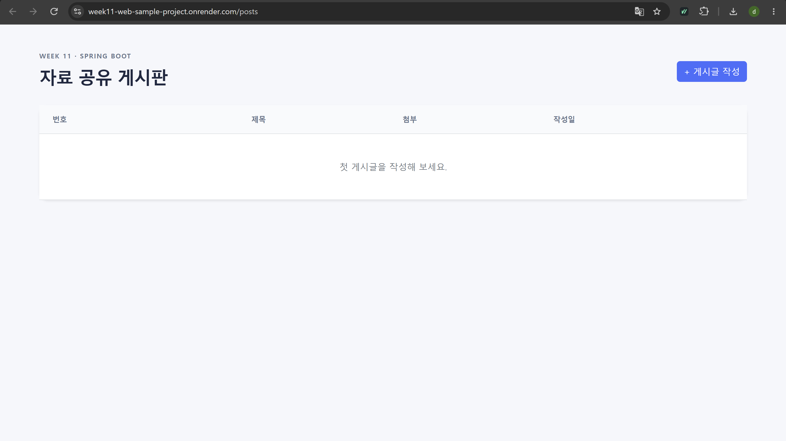
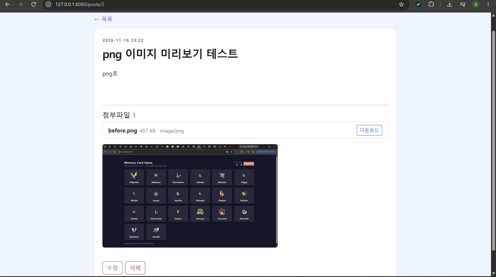
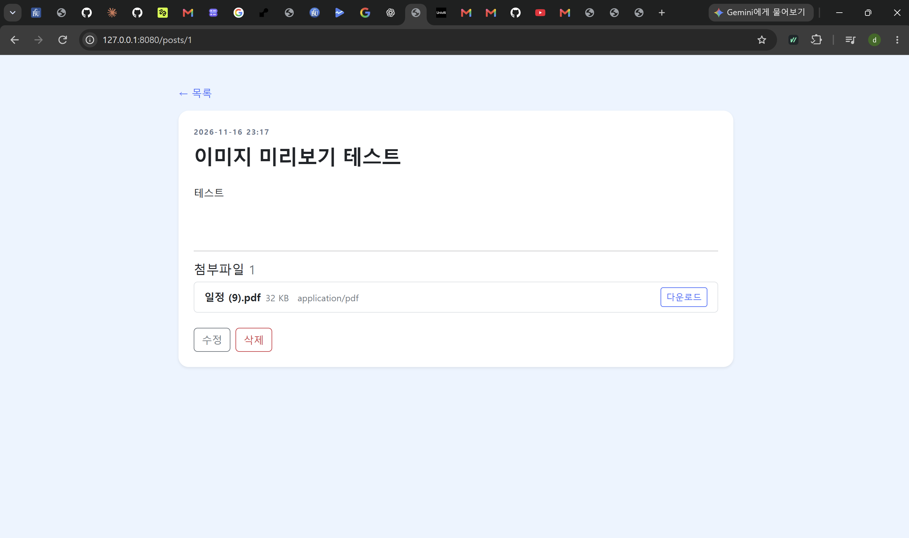
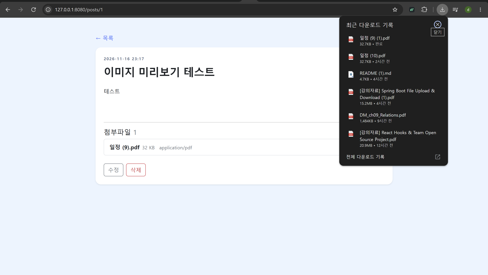

# Week 11 - Attachment Board

## 1. Project Information

### 프로젝트 소개

Spring Boot, Thymeleaf, JPA, MariaDB를 사용한 파일 첨부 게시판이다.

게시글을 작성하고 수정, 삭제할 수 있으며 파일 업로드와 다운로드 기능을 사용할 수 있다.

이번 과제에서는 기존 프로젝트의 코드를 분석하고 화면을 수정한 뒤 이미지 미리보기 기능을 추가했다.

### 주요 기능

- 게시글 작성, 조회, 수정, 삭제
- 여러 파일 업로드
- 첨부파일 다운로드
- JPG, JPEG, PNG, GIF 이미지 미리보기
- 파일 이름, 크기, 타입 표시

### Repository

- Sample Project: https://github.com/2026-2-WebService/week11_sample_project
- GitHub Repository: https://github.com/sondonghyeon333/web_assign11
- GitHub Classroom: https://github.com/2026-2-WebService/assign11-c01-22300385
- Render Deployment: https://web-assign11.onrender.com/posts

---

## 2. Installation

### 실행 환경

- Java 21
- Spring Boot 3.5.7
- Thymeleaf
- Spring Data JPA
- MariaDB
- IntelliJ IDEA
- DBeaver

### 실행 방법

1. GitHub에서 Sample Project를 Clone한다.
2. IntelliJ에서 프로젝트를 연다.
3. MariaDB 데이터베이스 연결을 설정한다.
4. application.properties에서 환경변수 설정을 확인한다.
5. AttachmentBoardApplication을 실행한다.
6. 브라우저에서 http://localhost:8080/posts 에 접속한다.

### 환경변수

- DB_URL: MariaDB 연결 주소
- DB_USERNAME: 데이터베이스 사용자 이름
- DB_PASSWORD: 데이터베이스 비밀번호

비밀번호는 GitHub에 올리지 않고 IntelliJ 환경변수로 설정했다.

### Sample Project 초기 실행 화면

---

## 3. Source Code Exploration & Analysis

### ① Source Code Analysis

Sample Project의 소스코드를 읽고 다음 8개 질문에 대한 답을 README.md에 자신의 말로 작성합니다.

### Project Structure & Spring MVC

**1. PostController, PostService, PostRepository는 각각 어떤 역할을 하며, 서로 어떻게 연결되는가?**

PostController는 사용자의 요청을 받고 화면을 연결하는 역할을 한다. PostService는 게시글을 저장하거나 수정, 삭제하는 기능을 처리한다. PostRepository는 JPA를 이용해 데이터베이스에 게시글 정보를 저장하고 조회한다. Controller가 Service를 호출하고 Service가 Repository를 사용하는 구조이다.

- 관련 파일 및 메서드: `PostController.java` - `create()`, `PostService.java` - `create()`, `PostRepository.java` - `saveAndFlush()`(상속 메서드)

**2. 게시글 작성 시 HTML Form의 입력값과 첨부파일은 Controller에 어떻게 전달되는가?**

HTML Form은 `multipart/form-data` 방식으로 입력값과 파일을 함께 보낸다. Controller에서는 `@ModelAttribute`로 제목과 내용을 `PostForm`에 받고, `@RequestParam`으로 첨부파일을 `MultipartFile` 목록에 받는다. 받은 내용과 파일은 Service로 전달된다.

- 관련 파일 및 메서드: `form.html` - 게시글 작성 Form, `PostController.java` - `create()`

### JPA & Entity Relationship

**1. Post와 Attachment Entity는 어떤 관계이며, @ManyToOne과 @OneToMany는 각각 어떤 역할을 하는가?**

게시글 하나에 첨부파일을 여러 개 넣을 수 있어서 일대다 관계이다. `@OneToMany`는 하나의 Post에 여러 Attachment가 연결되는 것을 나타낸다. `@ManyToOne`은 여러 Attachment가 하나의 Post에 속한다는 것을 나타낸다.

- 관련 파일 및 메서드: `Post.java` - `addAttachment()`, `Attachment.java` - `setPost()`

**2. cascade = CascadeType.ALL과 orphanRemoval = true는 어떤 역할을 하며, 실제 디스크에 저장된 파일에도 영향을 주는가?**

`CascadeType.ALL`은 게시글을 저장하거나 삭제할 때 연결된 첨부파일 정보에도 JPA 작업이 적용되게 한다. `orphanRemoval = true`는 게시글과 연결이 끊어진 첨부파일 정보를 DB에서 삭제하도록 한다. 하지만 실제 디스크에 저장된 파일은 자동으로 삭제되지 않기 때문에 따로 삭제해야 한다.

- 관련 파일 및 메서드: `Post.java` - `attachments` 관계 설정, `PostService.java` - `delete()`, `FileStorageService.java` - `deleteIfExists()`

### File Upload

**1. MultipartFile은 무엇이며, 업로드된 파일은 어떤 과정을 거쳐 서버에 저장되는가?**

`MultipartFile`은 사용자가 업로드한 파일을 Spring에서 처리할 때 사용하는 것이다. Controller가 파일을 받으면 Service에서 파일 이름과 형식, 크기를 검사한다. 문제가 없으면 서버의 `uploads` 폴더에 저장하고 파일 정보는 DB에 저장한다.

- 관련 파일 및 메서드: `PostController.java` - `create()`, `PostService.java` - `create()`, `FileStorageService.java` - `store()`

**2. 파일을 원본 이름 대신 UUID 기반 파일명으로 저장하는 이유는 무엇인가?**

서로 다른 사용자가 같은 이름의 파일을 올릴 수도 있기 때문이다. UUID를 사용하면 저장할 때 파일 이름이 겹치는 문제를 줄일 수 있다. 원래 파일 이름은 따로 보관해서 다운로드할 때 사용한다.

- 관련 파일 및 메서드: `FileStorageService.java` - `store()`, `Attachment.java` - `getOriginalFilename()`, `getStoredFilename()`

### File Download & Security

**1. 파일 다운로드 시 Resource, ResponseEntity, Content-Disposition은 각각 어떤 역할을 하는가?**

`Resource`는 서버에 저장된 파일을 읽어 전달할 때 사용한다. `ResponseEntity`는 파일 데이터와 HTTP 응답 정보를 함께 보내는 역할을 한다. `Content-Disposition`은 파일을 다운로드하도록 하고 원래 파일 이름을 지정한다.

- 관련 파일 및 메서드: `AttachmentController.java` - `download()`, `FileStorageService.java` - `load()`

**2. 파일 저장 과정에서 normalize()와 startsWith()를 사용하는 이유는 무엇인가?**

`normalize()`는 파일 경로를 정리하는 역할을 한다. `startsWith()`는 저장하려는 경로가 정해진 업로드 폴더 안에 있는지 확인한다. 이를 통해 다른 폴더에 잘못 접근하는 문제를 막을 수 있다.

- 관련 파일 및 메서드: `FileStorageService.java` - `store()`, `load()`

### ② Line-by-Line Code Comments

다음 3개 메서드의 주요 코드에 주석을 작성했다.

**1. PostController.create()**

- 게시글 작성 요청을 받는 과정
- 입력값의 오류 확인
- 게시글과 첨부파일을 Service에 전달하는 과정
- 저장 후 상세 페이지로 이동하는 과정

**2. FileStorageService.store()**

- 빈 파일인지 확인
- 파일 이름과 확장자 검사
- 파일 크기 검사
- UUID 파일명 생성
- 파일 저장 경로 확인
- 실제 파일 저장
- 파일 정보 반환

**3. AttachmentController.download()**

- 파일 ID로 첨부파일 정보 조회
- 실제 파일 불러오기
- 원본 파일명 설정
- ResponseEntity를 이용한 다운로드 응답 처리

기존 기능은 변경하지 않고 코드의 동작을 이해하기 위한 주석을 작성했다.

---

## 4. Customizing

### 1. Text 변경

- 수정 파일: `src/main/resources/templates/posts/list.html`
- 변경 전: 자료 공유 게시판
- 변경 후: 나의 파일 게시판

게시판 제목을 변경했다.

### 2. Style 변경

- 수정 파일: `src/main/resources/static/css/app.css`
- 변경 전: 배경색 `#f5f7fb`
- 변경 후: 배경색 `#eaf4ff`

게시판의 배경색을 연한 하늘색으로 변경했다.

### 3. UI/Data 변경

- 수정 파일: `src/main/resources/templates/posts/detail.html`
- 변경 전: 파일명과 파일 크기 표시
- 변경 후: 파일명, 파일 크기, 파일 타입 표시

Thymeleaf의 `file.contentType`을 사용하여 첨부파일의 종류도 표시하도록 수정했다.

기존 게시글 CRUD와 파일 업로드, 다운로드 기능은 그대로 유지했다.

---

## 5. New Feature Implementation

### 이미지 미리보기 기능

게시글 상세 화면에서 첨부한 이미지를 바로 확인할 수 있도록 이미지 미리보기 기능을 추가했다.

### 수정한 파일

**1. AttachmentController.java**

- `view()` 메서드 추가
- 파일 ID로 첨부파일 정보 조회
- JPG, JPEG, PNG, GIF 이미지 형식 확인
- Resource를 이용해 실제 파일 불러오기
- ResponseEntity의 Content-Type을 설정하여 이미지 전달

**2. detail.html**

- Thymeleaf의 `th:each`로 첨부파일 목록 확인
- `th:if`로 이미지 파일인지 확인
- `` 태그를 이용해 이미지 표시
- `th:src`로 이미지 미리보기 URL 연결

### 구현 내용

1. 이미지 파일은 게시글 상세 화면에서 바로 표시되도록 했다.
2. PDF와 TXT 파일은 기존 다운로드 기능을 유지했다.
3. 존재하지 않는 파일 ID는 404 오류가 나오도록 했다.
4. 이미지가 아닌 파일을 미리보기로 요청하면 400 오류가 나오도록 했다.

### 이미지 미리보기 실행 화면

---

## 6. Testing & Deployment

### 1. Local Testing

로컬 환경에서 게시글 작성과 파일 업로드, 다운로드 기능을 테스트했다.

**Sample Project 초기 실행 화면**

**파일 업로드 성공 화면**

PDF 파일을 첨부하여 게시글을 작성하고 첨부파일 목록에 표시되는 것을 확인했다.

**파일 다운로드 성공 화면**

첨부파일의 다운로드 기능을 테스트했다.

**이미지 미리보기 실행 화면**

JPG 또는 PNG 파일을 첨부하여 게시글 상세 화면에 이미지가 표시되는지 테스트했다.

### 2. 테스트 항목

- 게시글 작성
- 게시글 조회
- 게시글 수정
- 게시글 삭제
- 파일 업로드
- 파일 다운로드
- 이미지 미리보기
- 존재하지 않는 파일 ID 오류 처리
- 이미지가 아닌 파일의 미리보기 제한

### 3. GitHub & Render Deployment

- GitHub Repository: https://github.com/sondonghyeon333/web_assign11
- GitHub Classroom: https://github.com/2026-2-WebService/assign11-c01-22300385
- Render Deployment: https://week11-web-sample-project.onrender.com/posts

GitHub에 소스코드와 README.md, results 폴더를 Push하고 Render에서 배포 상태를 확인했다.

Render 배포 후에는 새 게시글을 작성하고 파일 업로드, 다운로드, 이미지 미리보기 기능을 다시 확인했다.

---

## 7. Weekly Review

### 1. Key Learning

**1. 파일 업로드 과정**

MultipartFile을 이용하여 사용자가 올린 파일을 받는 방법을 배웠다. 파일을 바로 저장하는 것이 아니라 이름과 크기, 형식을 검사한 뒤 저장한다는 것을 알게 되었다.

**2. 파일과 DB 정보의 차이**

실제 파일은 서버의 폴더에 저장하고 파일 이름이나 크기 같은 정보는 데이터베이스에 저장한다는 것을 배웠다. Post와 Attachment가 일대다 관계로 연결된다는 것도 알게 되었다.

**3. 파일 다운로드와 이미지 미리보기**

Resource와 ResponseEntity를 이용해 파일을 전달하는 방법을 배웠다. 다운로드는 파일을 저장하도록 하고 이미지 미리보기는 브라우저에서 바로 보여준다는 차이를 알게 되었다.

### 2. Problem & Solution

**문제 1. Gradle 빌드 오류**

처음에는 Gradle 빌드 과정에서 build 폴더를 삭제하지 못하는 오류가 발생했다.

실행 중인 프로그램을 종료하고 Gradle을 다시 실행하여 해결했다.

**문제 2. MariaDB 연결 오류**

Spring Boot 실행 중 Access denied 오류가 발생하여 데이터베이스에 연결되지 않았다.

DBeaver에서 연결 정보와 권한을 확인하고 application.properties 및 IntelliJ 환경변수 설정을 확인했다.

설정을 수정한 뒤 Spring Boot가 정상 실행되는 것을 확인했다.

**문제 3. GitHub Push 오류**

GitHub에 Push하는 과정에서 원격 저장소와 로컬 저장소의 내용이 달라 오류가 발생했다.

Git remote 연결과 Push 명령어를 확인하면서 해결 방법을 찾았다.

### 3. AI Usage

AI는  코드에서 이해되지 않는 부분을 질문하거나 오류를 해결할 때 사용했다.

- Controller와 Service의 코드 역할 질문
- 파일 업로드 및 다운로드 코드의 의미 질문
- Gradle 빌드 오류 해결 방법 질문
- MariaDB 연결 오류 원인 확인
- GitHub Push 오류 해결 방법 질문

### 4. Reflection

이번 과제를 하면서 Spring Boot에서 파일을 업로드하고 다운로드하는 과정을 조금 더 이해하게 되었다.

특히 파일을 서버에 저장하는 것과 데이터베이스에 파일 정보를 저장하는 것이 다르다는 점을 알게 되었다.

기존 코드를 읽고 수정하는 것이 아직 어렵지만, 강의자료와 코드를 비교하면서 Controller와 Service가 어떤 역할을 하는지 공부할 수 있었다.

앞으로는 오류가 발생했을 때 실행 로그를 조금 더 자세히 확인하고 직접 해결하는 연습을 해야겠다고 생각했다.
